# Azure Retail Data Engineering Pipeline

A complete end-to-end Azure data engineering project that ingests retail data from Azure SQL, orchestrates batch and incremental movement with Azure Data Factory, processes data through a Databricks Medallion Architecture, stores analytics-ready outputs in ADLS Gen2, and serves business insights through Power BI.

The project demonstrates practical data engineering patterns rather than a single notebook or isolated ETL script: metadata-driven ingestion, stateful watermark processing, cross-service orchestration, multi-task Databricks jobs, data-quality validation, Gold-layer aggregation, operational testing, and dashboard delivery.

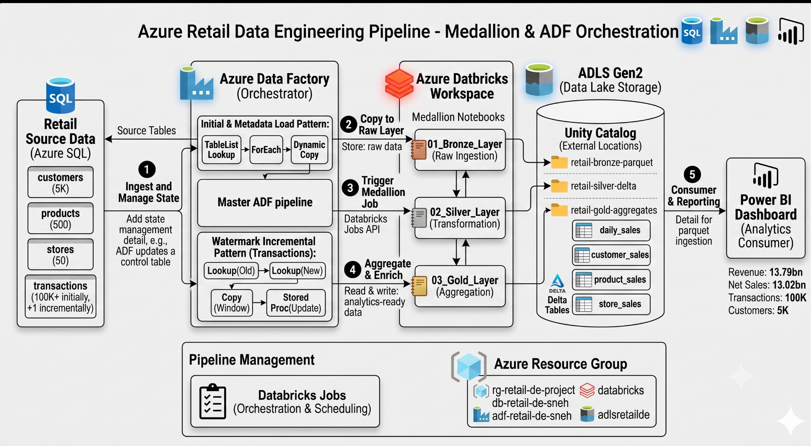

## Project Highlights

- End-to-end Azure data platform across SQL, ADF, ADLS Gen2, Databricks and Power BI
- Four Azure Data Factory pipelines for initial, metadata-driven, incremental and master orchestration workflows
- Watermark-based incremental loading that processes only new or changed transactions
- Metadata-driven ingestion using Lookup, ForEach and dynamic Copy activities
- Databricks Bronze, Silver and Gold notebooks implemented with PySpark
- Databricks multi-task workflow with explicit Bronze → Silver → Gold dependencies
- ADF-to-Databricks orchestration through the Databricks Jobs API
- Referential-integrity and row-count validation
- End-to-end incremental test proving that one newly inserted transaction moved through the pipeline
- Power BI executive dashboard backed by four Gold datasets
- Sanitized notebooks with no committed Databricks PAT or Bearer token

---

## Business Scenario

A retail organization has customer, product, store and transaction data that must be consolidated into an analytics platform. The solution must support both full onboarding of source tables and efficient recurring processing of newly arrived transactions.

The platform therefore needs to:

1. ingest source data into the Azure data platform;
2. avoid reloading the complete transaction history on every run;
3. maintain processing state safely;
4. clean and validate the ingested data;
5. create business-ready sales aggregates;
6. orchestrate dependencies across Azure Data Factory and Databricks; and
7. expose the final datasets through an executive Power BI dashboard.

---

## Architecture and Data Flow

**Retail CSV files → Azure SQL Database → Azure Data Factory → ADLS Gen2 → Azure Databricks → Gold datasets → Power BI**

The architecture separates ingestion, orchestration, transformation, storage and consumption responsibilities.

| Layer | Technology | Responsibility |
|---|---|---|
| Source | Azure SQL Database | Operational retail tables and watermark control |
| Ingestion | Azure Data Factory | Initial, metadata-driven and incremental movement |
| Orchestration | Azure Data Factory | Pipeline dependencies and Databricks job invocation |
| Storage | ADLS Gen2 | Source, Bronze, Silver and Gold zones |
| Processing | Azure Databricks / PySpark | Medallion transformations and validation |
| Serving | Gold datasets | Analytics-ready sales aggregates |
| Analytics | Power BI | Executive KPIs and interactive analysis |

An editable Mermaid version is available in [`architecture/data-flow-diagram.md`](architecture/data-flow-diagram.md).

---

## Azure Resources

The implementation is grouped inside the Azure resource group `rg-retail-de-project`.

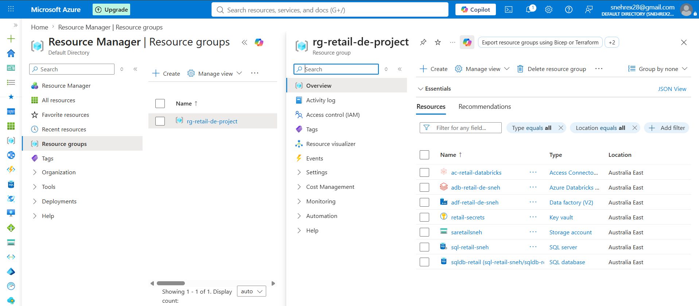

The project uses:

- Azure Databricks workspace
- Azure Data Factory
- Azure Data Lake Storage Gen2
- Azure SQL Server
- Azure SQL Database
- Azure Key Vault
- Azure Databricks Access Connector

The storage account is organized into `source`, `bronze`, `silver` and `gold` areas.

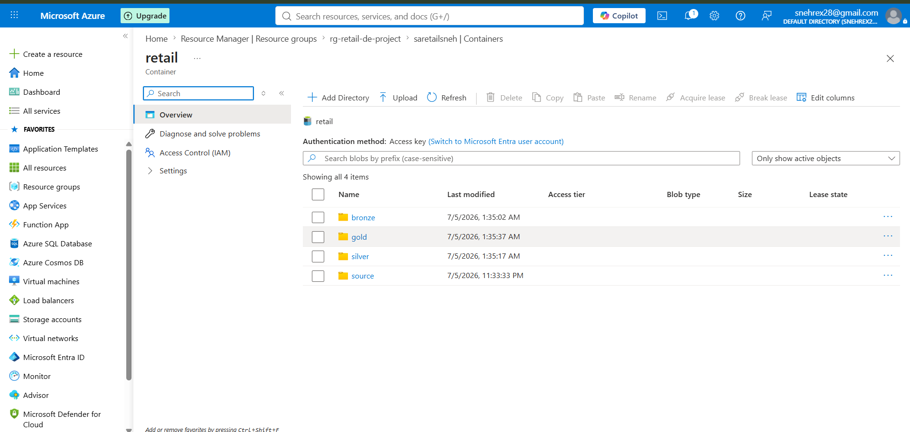

---

## Source Data

The repository includes the source CSV files used for the project.

| Dataset | Approximate volume | Purpose |
|---|---:|---|
| `customers.csv` | 5,000 rows | Customer master |
| `products.csv` | 500 rows | Product master |
| `stores.csv` | 50 rows | Store master |
| `transactions.csv` | 100,005 initial rows | Retail fact data |
| `transactions_dq_test.csv` | Test sample | Data-quality validation |

The source files are stored under `data/source/`.

The Azure SQL source contains customer, product, store, transaction and watermark-control objects.

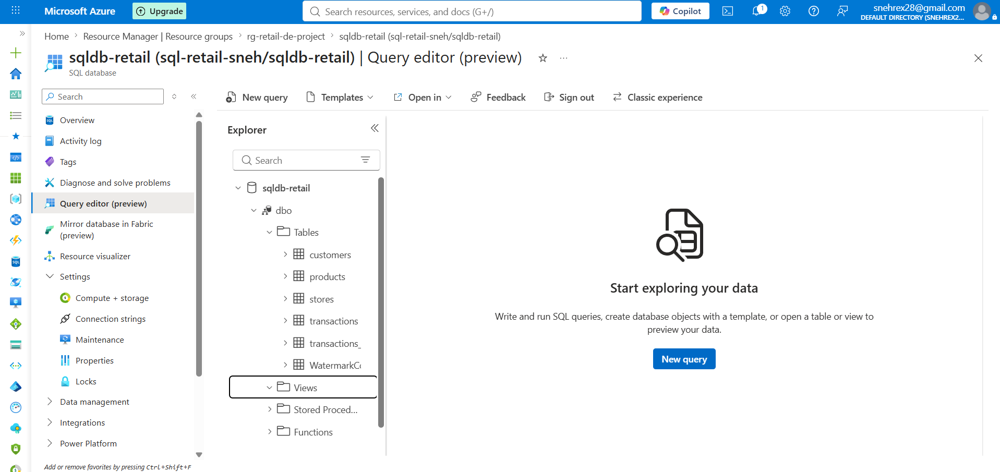

---

# Azure Data Factory

Azure Data Factory is responsible for ingestion and cross-service orchestration. Four pipelines were built.

## 1. Initial Customer Load

`PL_Initial_Load_Customers` was used to validate the first source-to-target data movement and column mappings.

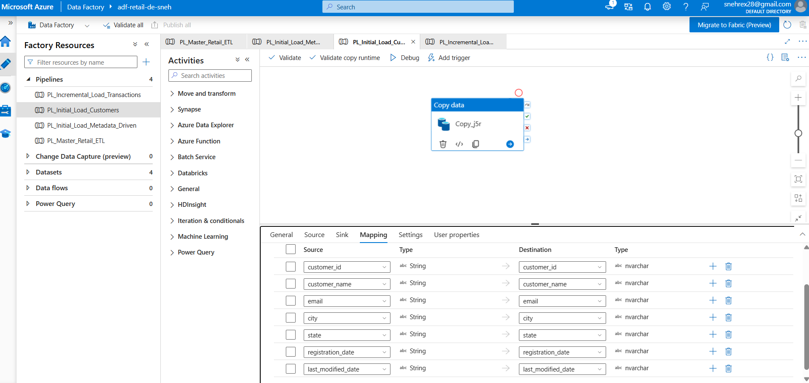

This established the basic connectivity between the Azure SQL source and the target data platform before the reusable ingestion patterns were introduced.

## 2. Metadata-Driven Initial Load

`PL_Initial_Load_Metadata_Driven` implements a reusable ingestion pattern.

The logical flow is:

**Lookup table list → ForEach table → Dynamic Copy activity**

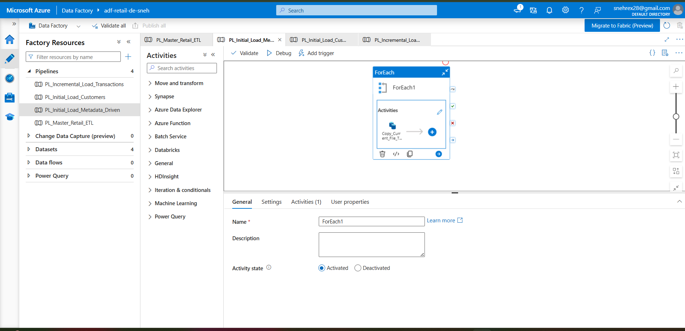

Instead of creating a separate pipeline for every source table, the pipeline reads metadata and iterates over the required objects. This reduces duplicated pipeline logic and makes onboarding additional tables easier.

## 3. Watermark-Based Incremental Load

`PL_Incremental_Load_Transactions` processes only new or changed transaction records.

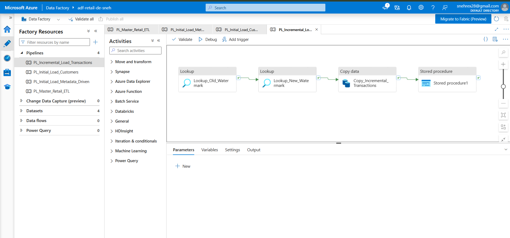

The activity sequence is:

1. `Lookup_Old_Watermark`
2. `Lookup_New_Watermark`
3. `Copy_Incremental_Transactions`
4. Stored procedure to persist the new watermark

The extraction window is bounded on both sides:

```sql
last_modified_date > OldWatermark
AND last_modified_date <= NewWatermark
```

This pattern is safer than filtering only on the lower boundary because every pipeline run works against a stable upper limit.

The watermark state is stored in a control table and updated only after the copy succeeds.

### Verified Incremental Run

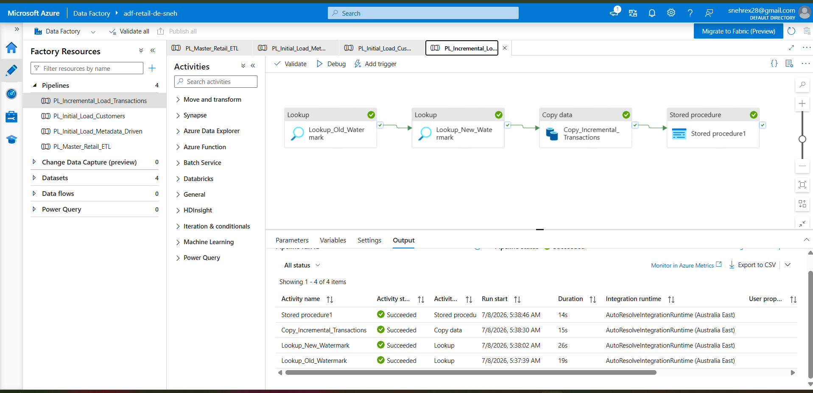

The successful run shows all four activities completing in order. The project test used:

- old watermark: `2026-07-06T15:05:00Z`
- new watermark: `2026-07-07T10:00:00Z`
- rows read: `1`
- rows copied: `1`
- test transaction ID: `100006`

This proves that the pipeline processed the new record instead of reloading the full transaction table.

## 4. Master Orchestration Pipeline

`PL_Master_Retail_ETL` coordinates the end-to-end workflow.

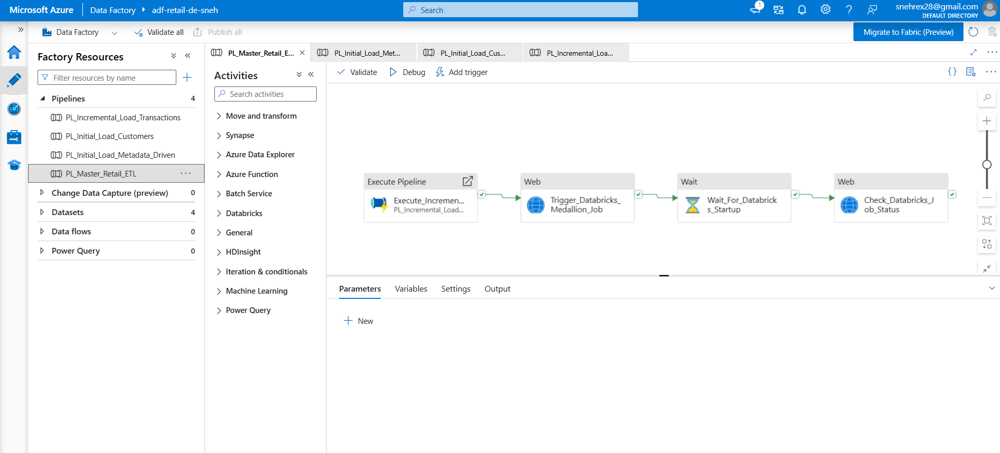

The sequence is:

1. execute the incremental ADF pipeline;
2. trigger the Databricks Medallion job through a Web activity;
3. wait for Databricks startup;
4. check the Databricks job status.

This design demonstrates orchestration across services rather than treating ADF and Databricks as independent components.

### Successful Master Run

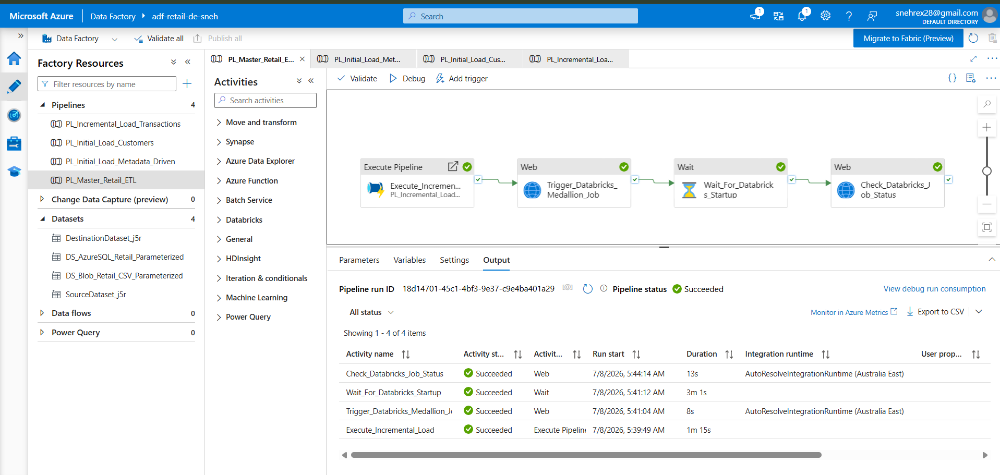

The screenshot verifies successful execution of:

- `Execute_Incremental_Load`
- `Trigger_Databricks_Medallion_Job`
- `Wait_For_Databricks_Startup`
- `Check_Databricks_Job_Status`

---

# Databricks Medallion Architecture

The repository includes the actual project notebooks:

- `databricks/notebooks/01_Bronze_Layer.ipynb`
- `databricks/notebooks/02_Silver_Layer.ipynb`
- `databricks/notebooks/03_Gold_Layer.ipynb`

The Databricks workflow executes them as dependent tasks.

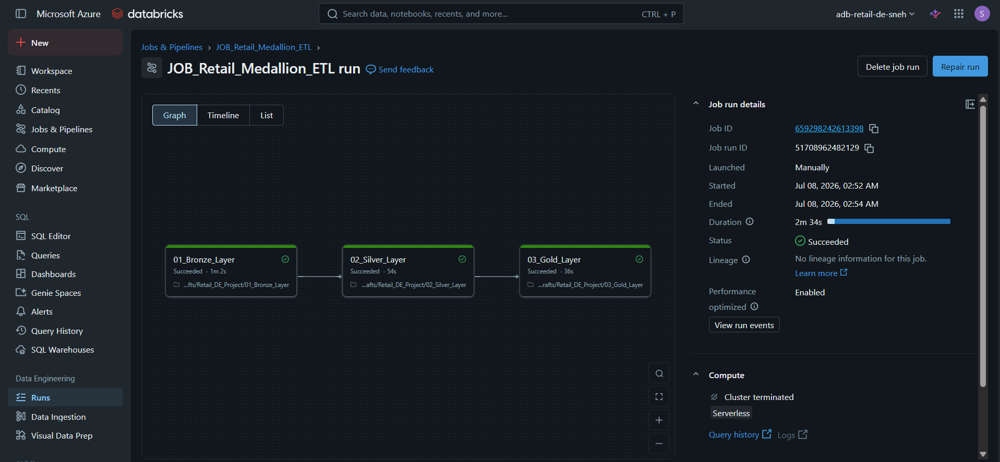

## Bronze Layer

The Bronze layer performs raw or minimally transformed ingestion and preserves source fidelity for downstream processing and troubleshooting.

Responsibilities include:

- reading landed source data;
- applying the initial schema and technical metadata;
- writing Bronze outputs; and
- preserving data for repeatable downstream transformations.

After the incremental test, the Bronze transaction count reached **100,006**.

## Silver Layer

The Silver layer converts raw data into validated, standardized and analysis-ready entities.

Responsibilities include:

- cleaning and standardizing fields;
- handling data types;
- validating business keys;
- checking relationships between transactions and dimension entities; and
- rejecting or identifying invalid records.

Verified data-quality results:

- invalid customer references: **0**
- invalid product references: **0**
- invalid store references: **0**
- Silver transaction count after incremental test: **100,006**

## Gold Layer

The Gold layer creates business-facing aggregates optimized for analytics.

The four outputs are:

| Gold dataset | Purpose |
|---|---|
| `daily_sales` | Daily revenue, net sales and transaction trends |
| `customer_sales` | Customer-level sales and transaction metrics |
| `product_sales` | Product and category performance |
| `store_sales` | Store-level performance |

The inserted incremental transaction was reflected in Gold with:

- transactions: **1**
- quantity: **2**
- total sales: **3,600**
- discount: **100**
- net sales: **3,500**

## Databricks Workflow Validation

The workflow history shows repeated successful executions of all three tasks.

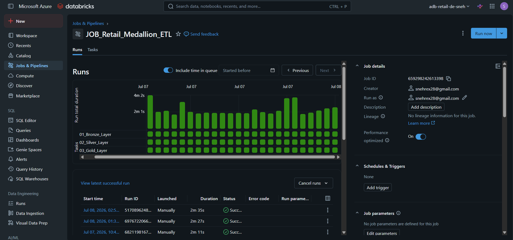

---

# Power BI Analytics

Power BI consumes the four Gold datasets and provides a single-page executive dashboard.

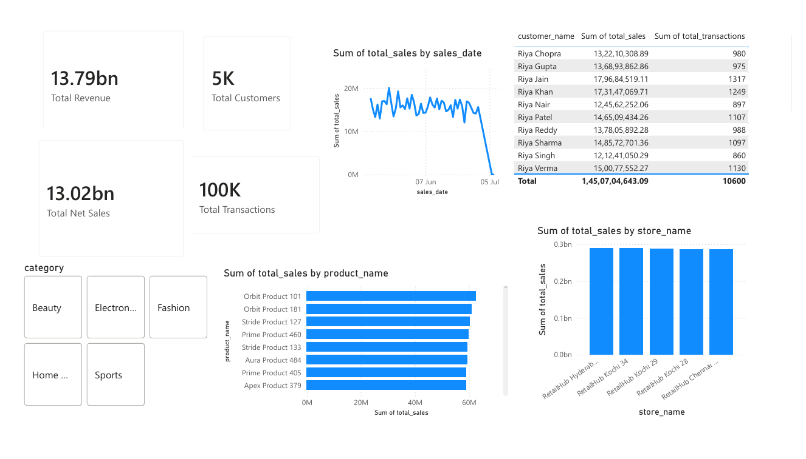

## Dashboard KPIs

- **Total Revenue:** 13.79bn
- **Total Net Sales:** 13.02bn
- **Total Transactions:** 100K
- **Total Customers:** 5K

## Dashboard Analysis

The report includes:

- revenue and net-sales KPI cards;
- transaction and customer KPI cards;
- sales trend by date;
- top product performance;
- store performance;
- customer-level sales analysis; and
- category filtering.

The Power BI layer intentionally consumes pre-aggregated Gold outputs rather than reproducing heavy transformation logic inside the report.

---

# End-to-End Validation

The final test demonstrates the complete path through the solution.

1. Initial transaction count was **100,005**.
2. A new transaction with ID `100006` was inserted.
3. The old watermark was read.
4. A new maximum watermark was calculated.
5. ADF extracted exactly **1** record.
6. ADF copied exactly **1** record.
7. The watermark was updated only after successful copy.
8. The master pipeline triggered Databricks.
9. Bronze completed with **100,006** transactions.
10. Silver completed with **100,006** valid transactions.
11. Gold aggregates reflected the new sale.
12. Power BI consumed the Gold layer.

This validates ingestion, state management, incremental processing, orchestration, transformation, quality checks and analytics delivery as one connected system.

---

# Repository Structure

```text
azure-retail-data-engineering-pipeline/
│
├── README.md
├── LICENSE
├── .gitignore
├── MISSING_ASSETS.md
├── SECURITY_SCAN.txt
│
├── architecture/
│   ├── retail-data-engineering-architecture.png
│   └── data-flow-diagram.md
│
├── azure-data-factory/
│   ├── pipelines/
│   │   └── README.md
│   ├── datasets/
│   │   └── README.md
│   └── screenshots/
│       ├── metadata-driven-pipeline.png
│       ├── initial-load.png
│       ├── incremental-pipeline-design.png
│       ├── incremental-pipeline-success.png
│       ├── master-pipeline-design.png
│       └── master-pipeline-success.png
│
├── databricks/
│   ├── notebooks/
│   │   ├── 01_Bronze_Layer.ipynb
│   │   ├── 02_Silver_Layer.ipynb
│   │   └── 03_Gold_Layer.ipynb
│   └── screenshots/
│       ├── databricks-job.png
│       └── databricks-run-history.png
│
├── data/
│   └── source/
│       ├── customers.csv
│       ├── products.csv
│       ├── stores.csv
│       ├── transactions.csv
│       └── transactions_dq_test.csv
│
├── sql/
│   ├── 01_create_source_tables.sql
│   ├── 02_create_watermark_control.sql
│   ├── 03_update_watermark_procedure.sql
│   ├── 04_incremental_test.sql
│   └── 05_validation_queries.sql
│
├── power-bi/
│   ├── README.md
│   └── screenshots/
│       └── retail-dashboard.png
│
├── screenshots/
│   └── end-to-end implementation evidence
│
└── docs/
    ├── project-implementation.md
    ├── incremental-loading.md
    ├── data-quality.md
    └── interview-notes.md
```

---

# Key Engineering Decisions

## Why Watermark-Based Loading?

The transaction table is the highest-volume and continuously changing dataset. Reloading the full history would waste compute, increase data movement and make the pipeline slower as data grows. A persisted watermark lets each run process only the required change window.

## Why Use Both Old and New Watermarks?

Using a fixed upper bound creates a deterministic batch. Records arriving after the new watermark is calculated are left for the next run rather than entering a moving extraction window.

## Why Metadata-Driven Ingestion?

Customer, product and store tables follow a similar movement pattern. Metadata and parameterized datasets allow one reusable pipeline to process multiple tables.

## Why Medallion Architecture?

The Bronze, Silver and Gold separation provides:

- source traceability;
- clean transformation boundaries;
- easier debugging;
- reusable validated datasets; and
- analytics-focused serving tables.

## Why Separate Gold Datasets?

Power BI receives purpose-built outputs rather than a large raw transaction table. This keeps business logic clearer and reduces unnecessary work in the semantic/reporting layer.

---

# Reliability and Data Quality

The implementation includes several reliability controls:

- bounded incremental extraction;
- watermark update after successful copy;
- explicit pipeline dependencies;
- Databricks task dependencies;
- row-count validation;
- referential-integrity checks;
- separate quality-test data; and
- end-to-end verification with a known inserted transaction.

Potential production enhancements include retry policies, centralized logging, alerting, quarantine tables, schema-evolution handling and idempotent merge logic.

---

# Security

The public repository must not contain:

- Databricks personal access tokens;
- storage account keys;
- SAS tokens;
- passwords;
- private connection strings; or
- service-principal secrets.

The notebook copies in this repository were scanned and sanitized before packaging. The final security scan reports no live `dapi...` token pattern or exposed Bearer token.

For production, prefer:

- Managed Identity;
- Azure Key Vault;
- Azure RBAC;
- secret scopes; and
- least-privilege access.

---

# How to Explore the Repository

1. Start with this README and the architecture diagram.
2. Review the ADF screenshots to understand ingestion and orchestration.
3. Open the Bronze, Silver and Gold notebooks in order.
4. Review the SQL folder for source, watermark and validation logic.
5. Read `docs/incremental-loading.md` for the incremental design.
6. Review the Power BI screenshot for the final analytics output.
7. Use `docs/interview-notes.md` to prepare a concise project explanation.

---

# Future Improvements

- Replace PAT-based Databricks invocation with stronger production authentication.
- Add Delta Lake `MERGE` for idempotent upserts.
- Add SCD Type 2 processing for changing dimensions.
- Add Azure Monitor / Log Analytics observability.
- Add failure notifications and SLA alerts.
- Add automated unit and integration tests.
- Add CI/CD for ADF and Databricks deployments.
- Add infrastructure as code with Terraform or Bicep.
- Add data lineage and governance through Unity Catalog.
- Add partitioning and optimization strategies for larger data volumes.

---

# Genuine Exports Still Needed

The repository does not fabricate platform export files that were never provided.

To make the repository fully redeployable, add the genuine exports listed in [`MISSING_ASSETS.md`](MISSING_ASSETS.md), especially:

- four ADF pipeline JSON exports;
- the Power BI `.pbix`; and
- the Power BI PDF export.

---

## Author

**Sneh Gupta**

Data Engineering | Azure | Databricks | PySpark | SQL | Power BI
